# omni-gateway 端到端（E2E）测试报告

> **重要：本文档是基于重构前构建（基线 commit `92b2970`）的一次测试记录。**
>
> 报告记录的是重构前版本的运行结果。此后后端已完成双账本重构，以下内容随之变化：
> - 对外消耗由「销售额」改为「积分」（保留 3 位小数）；上游成本仍为货币（CNY）。
> - `sale` / `sale_limit` 字段更名为 `credits` / `credit_limit`（Go 标识符、JSON 字段与数据库列；DB 列类型仍为 `NUMERIC`，由迁移 `0005_credits.sql` 应用）。
> - 毛利指标已整体移除：仪表盘不再有「毛利」卡片，统计 API 不再返回 `profit` 字段，两条账本并列展示（上游成本 ¥ vs 积分消耗）。
> - e2e 夹具的价格与预算已按积分重新标定：`mock-gpt-4o` v1 cost `{"input":"0.000002","output":"0.000004"}` CNY、credits `{"input":"0.0002","output":"0.0004"}` 积分，v2 追加 `image` cost `0.02` CNY、credits `2.000` 积分；`mock-claude` v1 cost `{"input":"0.000003","output":"0.000006"}` CNY、credits `{"input":"0.0002","output":"0.0004"}` 积分；预算用例改用 `cost_limit="1.00"`（宽松，CNY）与 `credit_limit="0.004"`（严格，积分），一次 mock chat 调用计 0.005 积分，首次调用即超上限，第 2–3 次调用返回 429。
>
> 因此，对同一矩阵重新运行将报告积分金额，并且不再有毛利卡片。**下文中的所有数字均为该重构前运行的历史记录，保留原样未作修改，不代表当前版本。**

| 项目 | 内容 |
| --- | --- |
| 被测系统 | omni-gateway（Go 后端 + Vue 3 管理控制台） |
| 代码基线 | `main` 分支，基线 commit `92b2970` + 本轮 P2/P3 修复（`records.go`、`App.vue`、`OperationsPane.vue`、审计归因） |
| 测试类型 | 系统级端到端测试（UI 控制台 + 网关数据面 + 真实 HTTP 上游 + PostgreSQL 持久化） |
| 执行日期 | 2026-09-18（含第二轮 P2/P3 补充验证） |
| 执行方式 | 真实浏览器驱动（ego-browser / Ego Lite Chromium）+ 真实 HTTP 调用；全部截图由浏览器现场采集 |
| 结论 | **通过**（23/23 用例通过；过程中发现 3 项缺陷，均已修复并有回归测试，详见 §7） |
| 覆盖范围 | 控制台配置链路、数据面协议矩阵、计费结算、鉴权与白名单、故障转移、限流与预算拦截、内容日志与审计、统计视图 |

---

## 1. 测试目标与范围

本次 E2E 的目标不是替换已有的单元/集成测试门禁（`scripts/test.sh`），而是验证**在真实运行态下，从管理控制台配置到数据面调用的完整闭环是否成立**：

1. 管理控制台可以完成登录并驱动全部配置写操作（供应商、模型目录、别名路由、价格、API 密钥）。
2. 网关数据面（`/v1/*`）可以用控制台签发的密钥发起真实推理请求，并同时支持**非流式**与**流式（SSE）**两种形态。
3. 请求完成后，**用量与不可变账本**中的计量项、成本、销售额必须与配置的价格版本逐项对得上。
4. 鉴权、白名单、上游故障转移等横切逻辑在真实链路中行为正确。
5. 控制台的统计与请求明细页面能够反映上述真实流量。

6. 6 种数据面协议形态（`chat_completions` / `responses` / `messages` / `embeddings` / `images` / 不支持协议）在 OpenAI 与 Anthropic 两类供应商上的路由与错误语义正确。
7. 限流（rpm / tpm / 并发）与预算规则在真实流量下的拦截点、以及规则解除后的自动恢复行为正确。
8. 内容日志（正文留存，加密落库）可被运维人员从控制台读取，且读取行为本身记入审计。

**范围内**：数据面推理链路（含 6 种协议形态）、控制台配置链路、计费结算、错误语义、故障转移、限流与预算拦截、内容日志与审计、统计视图。
**范围外**：多实例分布式协调（V1 明确非目标）、性能压测。第二轮已把原先「未覆盖」的协议矩阵、限流/预算拦截、内容日志纳入覆盖，并以可复现脚本固化（见 §10）。

## 2. 测试环境

| 组件 | 版本 / 配置 |
| --- | --- |
| 操作系统 | macOS（Darwin arm64） |
| Go | go1.23.12 darwin/arm64 |
| Node.js | v26.8.2 |
| PostgreSQL | 14.24 (Homebrew)，库 `llm_gateway_e2e` |
| 网关 | `backend/server`（`make build`，内嵌真实 Vue 控制台），监听 `127.0.0.1:18090` |
| 浏览器 | Ego Lite（ego-browser），视口 1470x836 |
| Mock 上游 | `scripts/e2e/mock_upstream.py`（Python 3 标准库，无第三方依赖），OpenAI 兼容，监听 `127.0.0.1:19099` |
| 测试驱动 | 浏览器人工驱动（控制台链路，§5）+ `scripts/e2e/` 脚本矩阵（数据面与策略链路，§6.6–§6.13，全部经真实 HTTP） |

关键环境变量：

```
GATEWAY_DB_URL=postgres://localhost:5432/llm_gateway_e2e?sslmode=disable
GATEWAY_LISTEN_ADDR=127.0.0.1:18090
GATEWAY_MASTER_KEY=<openssl rand -hex 32>
GATEWAY_ADMIN_USER=admin
GATEWAY_ADMIN_PASSWORD=E2eAdmin!2345
GATEWAY_ALLOW_PRIVATE_UPSTREAMS=true      # 允许指向 127.0.0.1 的本地上游
GATEWAY_BUSINESS_TZ=Asia/Shanghai
GATEWAY_CONTENT_LOGGING=true              # 开启正文留存，内容日志与审计用例依赖它
GATEWAY_CONTENT_LOG_MAX_BYTES=4096        # 单次请求正文留存上限
GATEWAY_SESSION_TTL=3600
```

测试数据：

| 项 | 值 |
| --- | --- |
| 管理员账号 | `admin` / `E2eAdmin!2345`（用户 1） |
| 供应商 A（OpenAI 兼容） | `mock-upstream` → `http://127.0.0.1:19099/v1` |
| 供应商 B（OpenAI 兼容） | `mock-upstream-b` → `http://127.0.0.1:19099/v1`（控制台用例的故障转移对端） |
| 供应商 C（Anthropic） | `mock-anthropic` → `http://127.0.0.1:19099` |
| 模型 | `mock-gpt-4o`（v1 / v2 价格）、`mock-gpt-4o-mini`、`mock-gpt-4o-slow`、`mock-claude` |
| 别名（控制台用例） | `mock-chat` |
| 别名（脚本矩阵，11 个） | `mock-chat` `mock-embed` `mock-image` `mock-responses` `mock-translate` `mock-slow` `mock-rpm` `mock-budget` `mock-unpriced` `mock-claude` `mock-unsupported` |
| 价格版本 | `mock-gpt-4o` v1：`input=0.000002, output=0.000004`；v2：v1 + `image=0.02`；销售价同构翻倍 |
| 价格版本 | `mock-claude` v1：成本 `input=0.000003, output=0.000006`；销售价 `input=0.000006, output=0.000012` |
| API 密钥 | 控制台用例 `e2e-key`（用户 1，白名单 `mock-chat`）；脚本矩阵 `e2e-key-chat` / `e2e-key-rpm`（rpm 2）/ `e2e-key-conc`（并发 1）/ `e2e-key-tpm`（tpm 1） |
| 限制规则 | 作用域 `key`：rpm 2、concurrency 1、tpm 1；预算规则 `sale_limit=0.00005`、`window=3600s`（按用例临时创建） |

> 说明：测试全程使用**独立的 E2E 数据库**与**独立端口**，不触碰本地开发库与 CI 使用的库；所有资源在测试后集中在一次性的 `llm_gateway_e2e` 库中。
## 3. 被测拓扑

```
  Browser (Ego Lite)  --http-->  管理控制台 (Vue 3, 内嵌于 Go 二进制)
                                        |  /api/admin/*  (会话 + CSRF)
                                        v
                                   omni-gateway :18090
                                        |  /v1/chat/completions (Bearer sk-llm-*)
                                        v
                              mock 上游 :19099 (OpenAI 兼容)

  omni-gateway  <--postgres-->  llm_gateway_e2e
```

## 4. 用例总览

| 用例 | 场景 | 结果 | 证据 |
| --- | --- | --- | --- |
| E2E-01 | 控制台登录（未认证访问被拦截） | 通过 | 01-login.png |
| E2E-02 | 登录后进入仪表盘（空态） | 通过 | 02-dashboard.png |
| E2E-03 | 新建供应商 `mock-upstream` | 通过 | 03-provider-form.png / 04-providers.png |
| E2E-04 | 供应商「发现模型」拉取上游模型列表 | 通过 | 05-model-discovery.png |
| E2E-05 | 模型目录保存能力位（流式/工具调用） | 通过 | 06-model-catalog.png |
| E2E-06 | 新建别名 `mock-chat` 并添加路由 | 通过 | 07-alias-route.png |
| E2E-07 | 新建价格版本 v1（成本/销售价） | 通过 | 08-price-form.png / 09-prices.png |
| E2E-08 | 新建 API 密钥并一次性展示明文 | 通过 | 10-key-form.png / 11-api-key-secret.png |
| E2E-09 | 非流式 `POST /v1/chat/completions` | 通过 | 见 §6.1 |
| E2E-10 | 流式 `POST /v1/chat/completions`（SSE） | 通过 | 见 §6.2 |
| E2E-11 | 鉴权与模型白名单边界 | 通过 | 见 §6.3 |
| E2E-12 | 计费账本与统计一致性 | 通过 | 12-dashboard-stats.png / 14-request-detail.png |
| E2E-13 | 上游 5xx 触发路由故障转移 | 通过 | 16-failover-routes.png / 17-failover-detail.png |
| E2E-14 | 原生协议矩阵：Embeddings / Images / Responses / Messages（原生直通 + 协议翻译） | 通过 | 见 §6.6 |
| E2E-15 | 供应商不支持该协议时返回 501 `unsupported`，而非笼统 502 | 通过 | 见 §6.7 |
| E2E-16 | RPM 限流拦截（`key` 作用域，2 次/分钟） | 通过 | 见 §6.8 |
| E2E-17 | TPM 令牌限流拦截（`key` 作用域，1 token/分钟） | 通过 | 见 §6.9 |
| E2E-18 | 并发限流拦截（`key` 作用域，并发 1，上游 2 s 慢响应） | 通过 | 见 §6.10 |
| E2E-19 | 预算规则拦截，以及规则停用后的自动恢复 | 通过 | 20-policy-rejections.png / 22-budget-rejection-detail.png / 见 §6.11 |
| E2E-20 | 内容日志留存（正文加密落库）与读取留痕 | 通过 | 18-audit-after.png / 见 §6.12 |
| E2E-21 | 分计量项计价与价格版本按请求固定 | 通过 | 见 §6.13 |
| E2E-22 | 控制台审计日志视图可用（§7.1 缺陷修复验证） | 通过 | 18-audit-after.png |
| E2E-23 | 结算异常（`unpriced`）的界面说明与导流（§7.2 缺陷修复验证） | 通过 | 19-unpriced-hint.png / 21-policy-rejection-detail.png |

**汇总：23 / 23 通过。**（E2E-01…E2E-13 为第一轮控制台 + 数据面链路；E2E-14…E2E-23 为第二轮新增的协议矩阵、策略拦截、内容日志与控制台修复验证，全部由 `scripts/e2e/` 脚本或浏览器现场复核。）

## 5. 用例执行详解

### E2E-01 控制台登录

未登录访问 `/` 时控制台呈现登录表单；使用管理员账号登录成功并跳转至仪表盘。

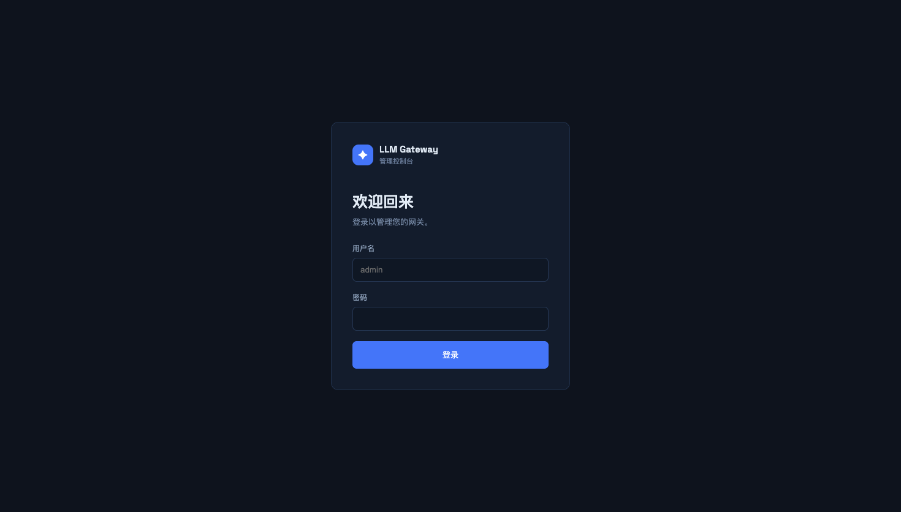

### E2E-02 仪表盘（初始空态）

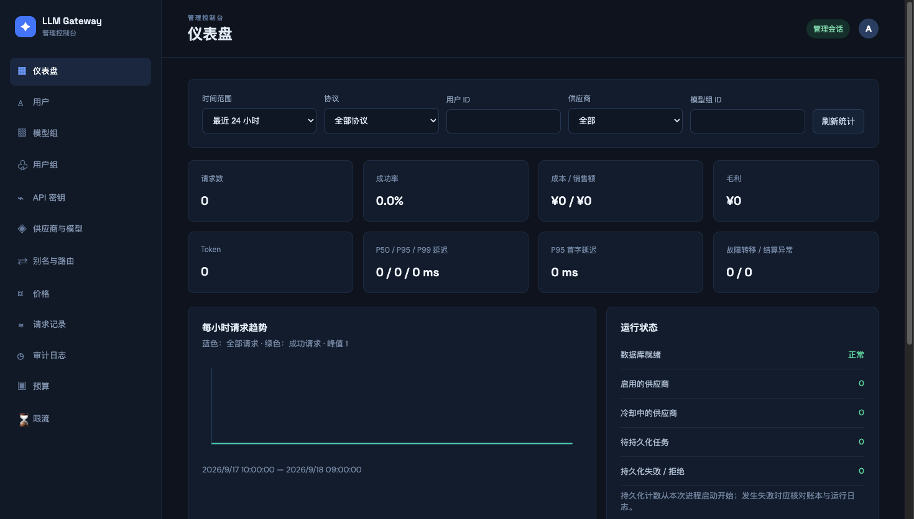

### E2E-03 新建供应商

在「供应商与模型」中新建 `mock-upstream`，`base_url` 指向本地 mock 上游 `http://127.0.0.1:19099/v1`。保存后列表显示为「可用」。

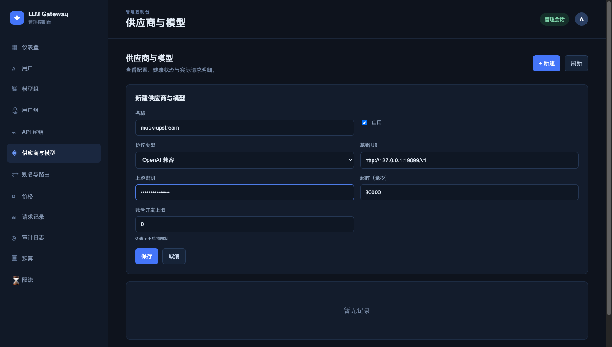

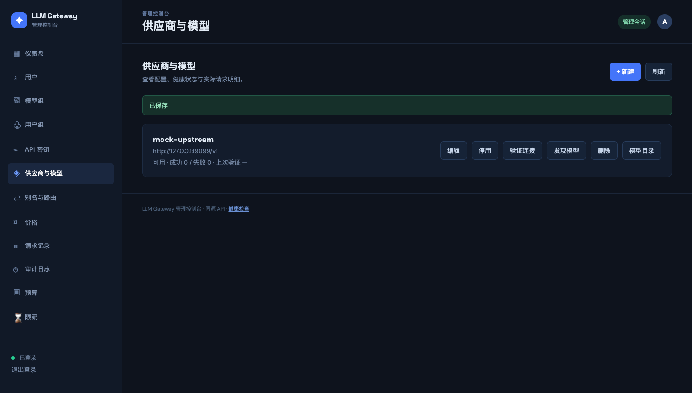

### E2E-04 发现模型

点击「发现模型」后，网关向 `GET {base_url}/models` 发起探测，提示「模型发现完成，发现 2 个模型」，同时把上游健康状态与 `last_verified_at` 落库。

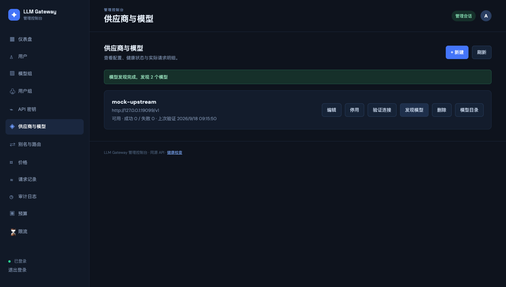

### E2E-05 模型目录与能力位

「模型目录」已列出 `mock-gpt-4o` / `mock-gpt-4o-mini`。勾选 `mock-gpt-4o` 的「流式」「工具调用」后点击「保存能力」，提示「模型能力已保存」。
经同源 API 复核 `/api/admin/providers/1/models`，能力位持久化正确。

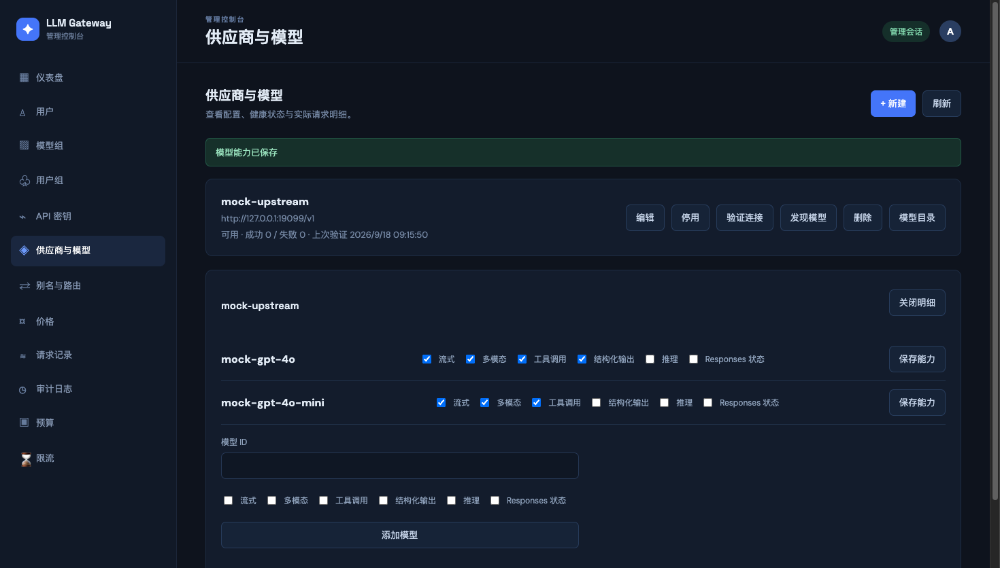

### E2E-06 别名与路由

新建别名 `mock-chat`，随后在「配置路由」中添加路由：供应商 `mock-upstream`、上游真实模型名 `mock-gpt-4o`、优先级 `10`。

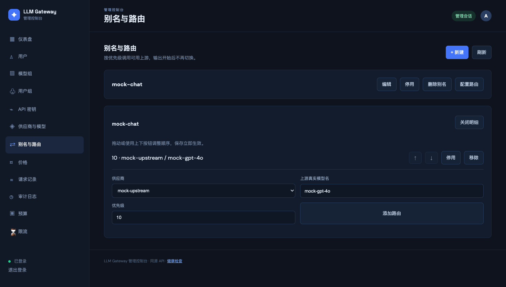

### E2E-07 价格版本

为 `mock-gpt-4o` 创建价格版本 v1：

```json
成本   {"input":"0.000002","output":"0.000004"}
销售价 {"input":"0.000004","output":"0.000008"}
```

界面明确提示「价格版本是不可变快照，创建后不可修改或删除」。

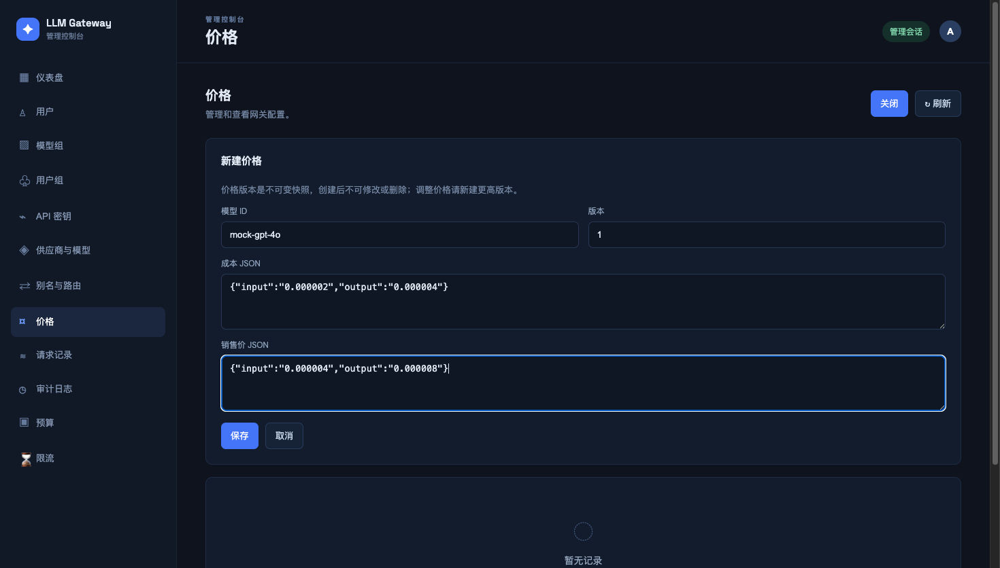

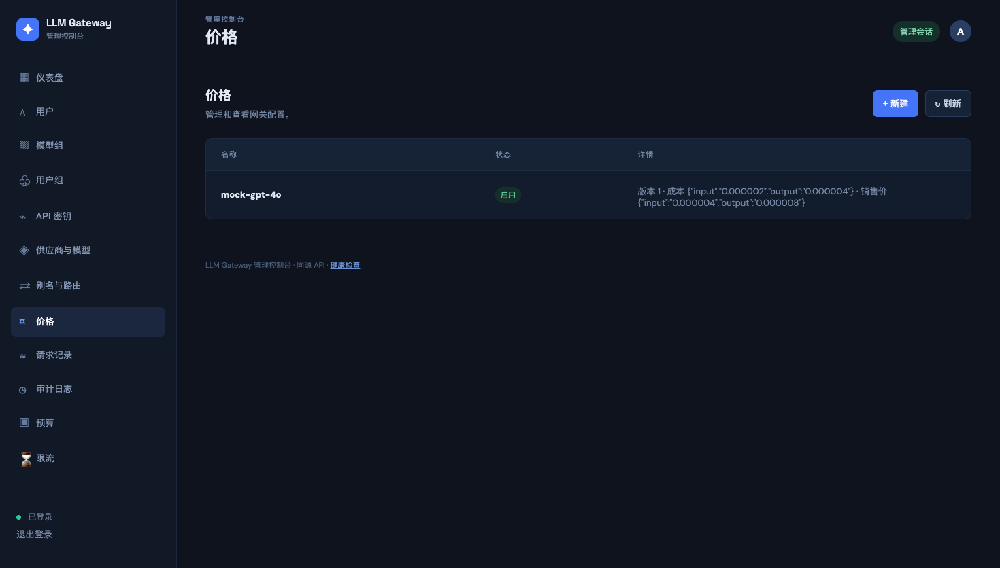

### E2E-08 API 密钥

新建密钥 `e2e-key`（用户 1、白名单 `mock-chat`）。创建后界面**一次性**展示明文，并提示「请立即复制此 API 密钥。原始密钥不会再次显示。」

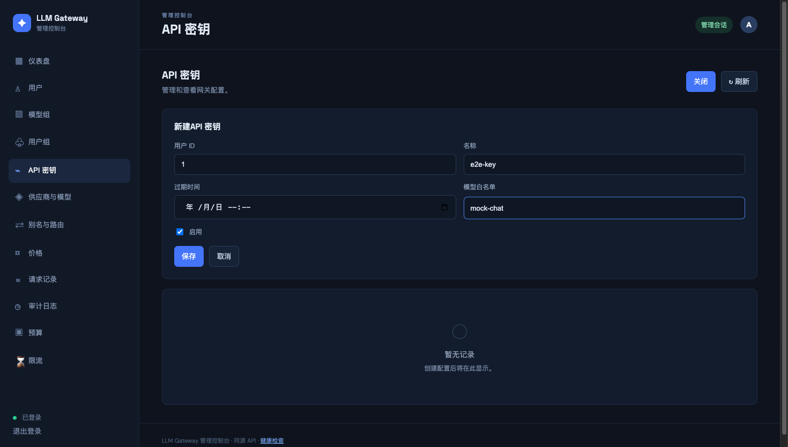

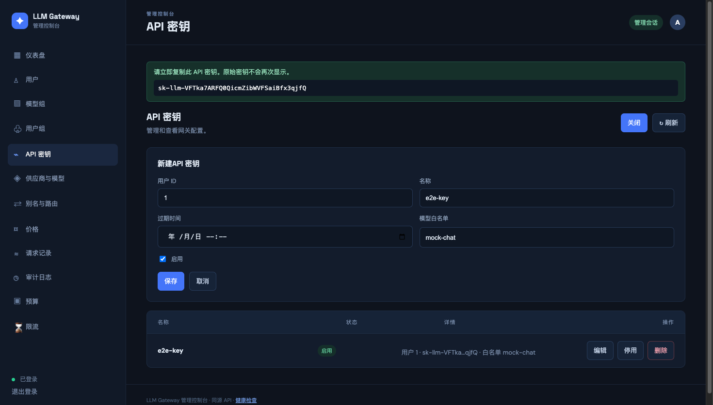

## 6. 数据面验证（真实 HTTP 调用）

下列调用均使用控制台签发的密钥（`sk-llm-…`，仅存在于一次性 E2E 库中）；第二轮脚本矩阵所用的密钥由 `scripts/e2e/setup.py` 签发并写入 gitignored 的 `scripts/e2e/fixtures.json`。

> **请求标识约定（重要）**：网关同时返回两个 ID。`X-Request-Id` 是面向调用方的追踪 ID——允许调用方自带、因而可能重复，错误信封中的 `request_id` 回显的就是它；`X-Gateway-Request-Id` 是服务端自有的记录 ID，等于 `requests.id`，同时也是 `attempts.request_id` 与 `content_log.request_id`。**按记录查库或查内容日志必须用 `X-Gateway-Request-Id`，不能用信封中的 `request_id`。**

### E2E-09 非流式推理

```bash
curl -s -X POST http://127.0.0.1:18090/v1/chat/completions \
  -H "Authorization: Bearer $KEY" -H "Content-Type: application/json" \
  -d '{"model":"mock-chat","messages":[{"role":"user","content":"你好，请自我介绍"}]}'
```

响应 `200 OK`，并带网关自有追踪头：

```
X-Gateway-Request-Id: 28544754c046a0571ef003416256504e
X-Request-Id: f3d6549cc74d44e38f002a04682ae111
```

```json
{"id":"chatcmpl-mock-1","object":"chat.completion","created":1789694278,"model":"mock-chat",
 "choices":[{"index":0,"message":{"role":"assistant","content":"这是来自 mock 上游的回复。"},"finish_reason":"stop"}],
 "usage":{"prompt_tokens":11,"completion_tokens":7,"total_tokens":18}}
```

要点：客户端请求的是**别名** `mock-chat`，网关回包中的 `model` 也保持为别名（不泄漏上游真实模型名），用量由上游 `usage` 原样透传。

### E2E-10 流式推理（SSE）

请求体加入 `"stream": true`，响应 `Content-Type: text/event-stream`。

```bash
curl -s -N -X POST http://127.0.0.1:18090/v1/chat/completions \
  -H "Authorization: Bearer $KEY" -H "Content-Type: application/json" \
  -d '{"model":"mock-chat","stream":true,"messages":[{"role":"user","content":"流式测试"}]}'
```

SSE 帧序列（共 6 帧 + 结束标记）：

| # | 帧内容摘要 |
| --- | --- |
| 1 | delta.role = assistant |
| 2 | delta.content = 这是来自 m |
| 3 | delta.content = ock 上游 |
| 4 | delta.content = 的回复。 |
| 5 | delta 为空，finish_reason = stop |
| 6 | choices 为空，usage = input 11 / output 7 / total 18 |
| 7 | 结束标记 |

响应头：`Content-Type: text/event-stream`，`X-Gateway-Request-Id: fd89183824620ab799379ca5e0807fce`。

结论：流式透传正常，增量内容分片送达，并在结尾前注入用量帧后以结束标记收尾。

> **过程记录（网关行为观察）**：首次流式测试时，mock 上游在发送完用量帧后**未发送结束标记**便关闭连接。
> 网关没有把这次调用记为成功，而是在流的末尾追加了一帧对外错误（`upstream_error`），并把该次尝试记为 `error / 502`（见 §7.3）。
> 这属于**预期行为**：上游 SSE 未正常收尾时不应静默当作成功。修正 mock 后流式全程干净通过。

### E2E-11 鉴权与模型白名单边界

| 场景 | 请求 | 状态码 | 错误码 |
| --- | --- | --- | --- |
| 未携带密钥 | `POST /v1/chat/completions` | 401 | `api_key_required` |
| 携带伪造密钥 | `Authorization: Bearer sk-llm-bogus` | 401 | `invalid_api_key` |
| 密钥不在白名单内 | `model = mock-gpt-4o-mini`（白名单仅 `mock-chat`） | 403 | `model_not_allowed` |
| 密钥合法 | `GET /v1/models` | 200 | —（仅返回别名 `mock-chat`） |

结论：鉴权在三处均正确失败，且错误体统一为 `{"error":{"message","type","code","request_id"}}`；`/v1/models` 只暴露别名，不暴露上游真实模型名。

### E2E-12 计费账本与统计一致性

以请求 `00671ee830268c5207d38bb79c177e2a` 为例，界面「请求明细」中的**不可变账本**如下：

| 尝试 | 计量项 | 数量 | 成本 | 销售额 | 价格版本 |
| --- | --- | --- | --- | --- | --- |
| 76c9c1d9 | input | 11 | 0.000022 | 0.000044 | 1 |
| 76c9c1d9 | output | 7 | 0.000028 | 0.000056 | 1 |
| 76c9c1d9 | total | 18 | 0 | 0 | 1 |

逐项验算（价格版本 v1：成本 input `0.000002` / output `0.000004`；销售价 input `0.000004` / output `0.000008`）：

- `11 x 0.000002 = 0.000022`，`11 x 0.000004 = 0.000044`
- `7 x 0.000004 = 0.000028`，`7 x 0.000008 = 0.000056`
- 合计：成本 `0.00005`，销售额 `0.0001` —— 与明细页「总耗时 6 ms · 首字 6 ms · 销售额 ¥0.0001」及列表「成本 ¥0.00005」完全一致。

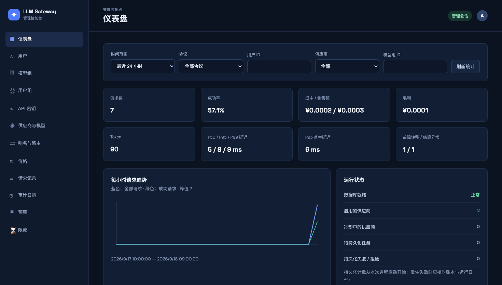

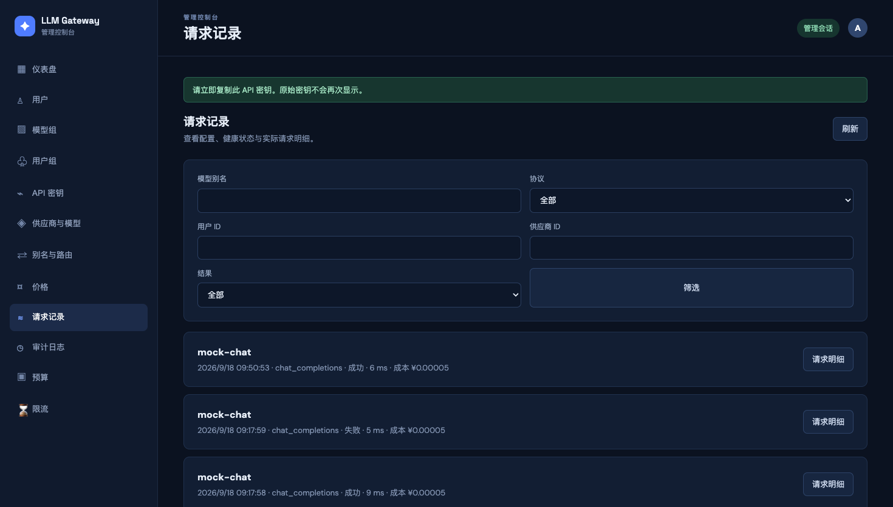

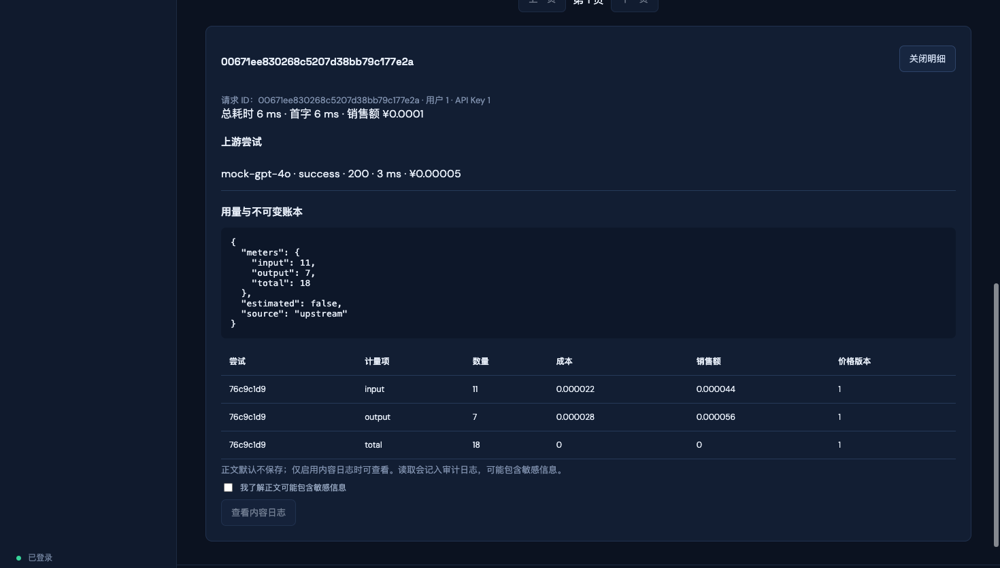

全库账本汇总（`SELECT sum(cost), sum(sale) FROM usage_ledger`）：`cost = 0.000200`，`sale = 0.000300`，共 12 行（4 次计价尝试 × 3 个计量项）。

仪表盘同时显示：

| 指标 | 值 |
| --- | --- |
| 请求数 | 7 |
| 成功率 | 57.1% |
| 成本 / 销售额 | ¥0.0002 / ¥0.0003 |
| 毛利 | ¥0.0001 |
| Token | 90 |
| P50 / P95 / P99 延迟 | 5 / 8 / 9 ms |
| P95 首字延迟 | 6 ms |
| 故障转移 / 结算异常 | 1 / 1 |

### 结算语义验证（重要）

账本中有 4 次计价尝试，但销售额只有 `0.0003`（= 3 次 x 0.0001）。差额来自请求 `fd89183824620ab799379ca5e0807fce`：

```
input  | 11 | cost 0.000022 | sale 0
output |  7 | cost 0.000028 | sale 0
```

这是**符合设计**的行为，`backend/internal/billing/billing.go` 中已明确注释：

> Sale is emitted only when success is true; upstream failures still contribute their configured Cost.

即：**上游失败仍然计入成本（平台承担），但不向客户计销售**。E2E 在真实数据上验证了该策略生效。

### E2E-13 上游故障转移

构造方式：别名 `mock-chat` 配置两条路由，优先级数值小者先试。

| 优先级 | 供应商 | 上游真实模型名 | 预期 |
| --- | --- | --- | --- |
| 0 | `mock-upstream-b` | `broken-model`（mock 返回 500） | 失败，触发故障转移 |
| 10 | `mock-upstream` | `mock-gpt-4o` | 成功 |

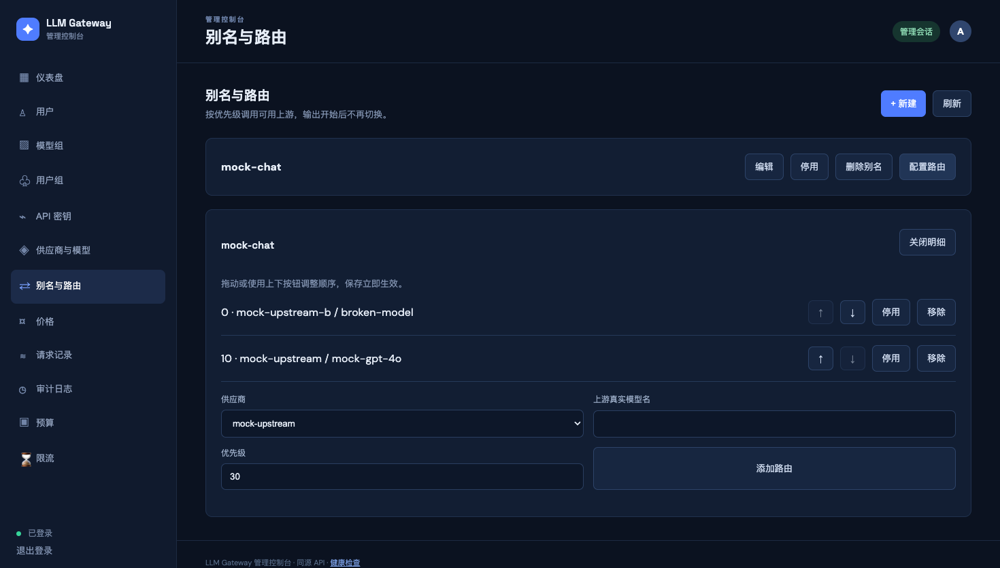

调用结果：客户端收到 `200 OK` 与正常补全内容，对失败一无所知。请求明细显示两次尝试：

```
上游尝试
broken-model  · error   · 500 · 0 ms · ¥0        upstream server error
mock-gpt-4o   · success · 200 ·  3 ms · ¥0.00005
```

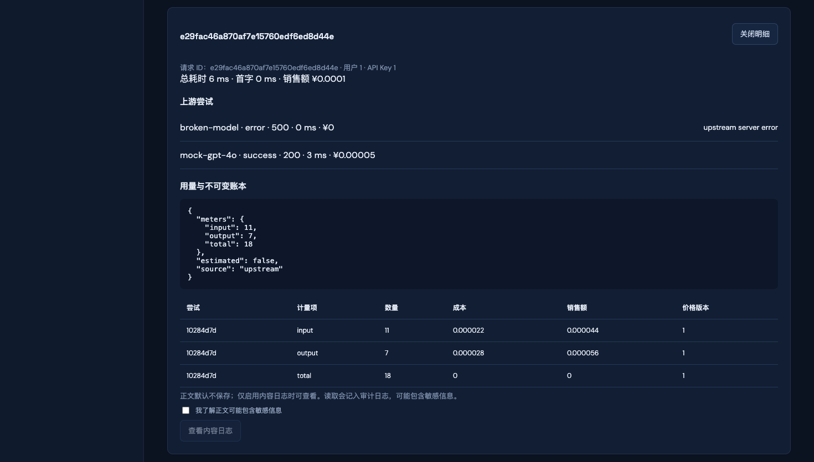

**重要边界（按设计）**：故障转移只对**可重试**错误生效。`backend/internal/adapter/adapter.go`：

```go
func (e *Error) IsRetryable() bool {
	switch e.Type {
	case "connection", "timeout", "rate_limit", "server":
		return true
	default:
		return false
	}
}
```

实测验证：把首路由的上游模型改成不存在的模型（上游返回 `404`）时，网关**不会**切换路由，而是直接返回 `upstream_error`，并把该次尝试记为 `error / 404`——调用方配置错误不应被故障转移掩盖。这一正一反两组对照，说明重试判定边界是正确实现的。

### 附：供应商冷却与「无可用路由」

上一步中，`mock-upstream` 连续两次上游失败后被标记为 `health_status = cooldown`：

```json
{"id":1,"name":"mock-upstream","success_count":3,"failure_count":2,
 "last_error":"retryable upstream failure","health_status":"cooldown",
 "cooldown_until":"2026-09-18T09:51:58.09673+08:00"}
```

冷却期间，当别名下**所有**路由都指向冷却中的供应商时，网关返回：

```json
{"error":{"message":"no active route for model alias","type":"server_error",
          "code":"no_route","request_id":"4b94dff940cec5dd7887873aec16002f"}}
```

状态码 `503`。冷却到期后无需任何人工干预，路由自动恢复可用（后续调用即成功，见 E2E-13）。这验证了健康检查与冷却有一个完整的「失败降级 → 自动恢复」闭环。

### 6.6 E2E-14 原生协议矩阵

`scripts/e2e/native_matrix.py` 把同一批别名打到 5 个 `/v1/*` 面上，外加 1 个不支持组合，逐个断言 HTTP 判决：

| # | 场景 | 供应商类型 | 期望 | 实测 | 上游计量 |
| --- | --- | --- | --- | --- | --- |
| 1 | `POST /v1/embeddings` | OpenAI 兼容 | 200 | 200 | prompt 8 / total 8 |
| 2 | `POST /v1/images/generations` | OpenAI 兼容 | 200 | 200 | input 4 / output 0 / total 4 |
| 3 | `POST /v1/responses` | OpenAI 兼容 | 200 | 200 | input 10 / output 6 / total 16 |
| 4 | `POST /v1/messages`（原生直通） | Anthropic | 200 | 200 | input 9 / output 5 |
| 5 | `POST /v1/messages`（翻译为 chat/completions） | OpenAI 兼容 | 200 | 200 | input 11 / output 7 |
| 6 | `POST /v1/embeddings` | Anthropic | 501 | 501 | — |

脚本原始输出（节选）：

```
== [PASS] POST /v1/messages on an Anthropic provider (native passthrough) -> 200 (expected 200)
     {"model": "mock-claude", "id": "msg_mock", "usage": {"input_tokens": 9, "output_tokens": 5}}
== [PASS] POST /v1/messages on an OpenAI provider (translated) -> 200 (expected 200)
     {"model": "mock-translate", "id": "chatcmpl-mock-1", "usage": {"input_tokens": 11, "output_tokens": 7}}
== [PASS] POST /v1/embeddings on an Anthropic provider (unsupported) -> 501 (expected 501)
     error=operation_unsupported/server_error
native protocol matrix: all verdicts match
```

要点：第 4、5 行说明 `/v1/messages` 是**按目标供应商类型分流**的——路由到 Anthropic 供应商时原生直通，路由到 OpenAI 供应商时被翻译为 `chat/completions`；两种情况下回包中的 `model` 都保持客户端请求的别名。第 6 行是下一节的主题。

### 6.7 E2E-15 不支持协议返回 501（而非 502）

**这是本轮发现并修复的第 3 个缺陷**（详见 §7.4）。修复后实测：

```
HTTP/1.1 501 Not Implemented
X-Gateway-Request-Id: 92c08e8f4f0e51258867cbd46f0503cf
X-Request-Id: 944e1815c9ef06633f5872824ee9b482

{"error":{"message":"the selected provider does not support this operation",
          "type":"server_error","code":"operation_unsupported",
          "request_id":"944e1815c9ef06633f5872824ee9b482"}}
```

落库记录与客户端判决**逐项一致**（修复前不一致，见 §7.4）：

```sql
SELECT id, status_code, error_type, error_summary FROM requests WHERE error_type = 'unsupported';
-- f0fc52a879af6c7578b4b5d854c94a85 | 501 | unsupported | the selected provider does not support this operation
-- 7cac84a17f8afe4967940427423e414a | 501 | unsupported | the selected provider does not support this operation
-- e441930c5ab5c204c4db3ae10bff64f0 | 501 | unsupported | the selected provider does not support this operation
-- b24eb1fbd3091837b55d999ced5c3b5d | 501 | unsupported | the selected provider does not support this operation
```

这 4 条记录**都没有任何上游尝试行**：

```sql
SELECT r.id, count(a.request_id) AS attempts FROM requests r
  LEFT JOIN attempts a ON a.request_id = r.id
 WHERE r.error_type = 'unsupported' GROUP BY r.id;
-- 4 行，attempts 全部为 0
```

网关在解析路由时即判定该供应商不具备此能力，不会「先打上游再失败」。这既避免了无谓的上游调用，也解释了为什么这类拒绝不会把供应商推进冷却。

### 6.8 E2E-16 RPM 限流

`e2e-key-rpm` 绑定 `scope=key, rpm=2`。等一个干净的一分钟窗口后连续调用 3 次：

```
== [PASS] RPM limit = 2 on one key, 3 sequential calls
     200 ok
     200 ok
     429 rate_limited
     codes: [200, 200, 429] (expected [200, 200, 429])
```

### 6.9 E2E-17 TPM 令牌限流

`e2e-key-tpm` 绑定 `scope=key, tpm=1`。第一次调用即耗尽令牌额度，第二次被拒：

```
== [PASS] TPM limit = 1 on one key, 2 sequential calls
     200 ok
     429 rate_limited
     codes: [200, 429] (expected [200, 429])
```

TPM 与 RPM 是**两套独立计数器**，但共用同一个 `rate_limited` 错误码——从调用方视角二者不可区分，从 `rate_limits` 配置（`rpm` / `tpm` / `concurrency` 三个字段）可区分。

### 6.10 E2E-18 并发限流

`e2e-key-conc` 绑定 `scope=key, concurrency=1`；别名 `mock-slow` 指向 `mock-gpt-4o-slow`，mock 上游对该模型 `sleep 2`。用 `threading.Barrier` 让两个线程**同时**发起请求：

```
== [PASS] Concurrency limit = 1 on one key, 2 parallel calls to a 2s upstream
     429 rate_limited
     200 ok
     codes: [429, 200] (expected [200, 429], any order)
```

并发场景下两个请求的完成顺序本质是竞态的，因此断言的是**判决集合**而非顺序（脚本中 `order_matters=False`）。上游 2 s 的延迟保证两个请求的窗口真实重叠——否则该用例会退化成一次普通的串行通过，失去意义。

### 6.11 E2E-19 预算拦截与自动恢复

用例自建资源，不依赖任何历史遗留状态：先停用全部已有预算规则（本次运行停用 0 条 / 共 7 条，说明上一轮已自行清理），再新建用户 `e2e-budget-<ts>`、密钥与规则 `sale_limit=0.00005`、`window=3600s`，随后连续调用 3 次：

```
== [PASS] Budget sale_limit = 0.00005, fresh user, 3 sequential calls
     200 ok
     429 budget_exceeded
     429 budget_exceeded
     codes: [200, 429, 429] (expected [200, 429, 429])
== [PASS] Same budget key after the rule is deactivated, 2 sequential calls
     200 ok
     200 ok
     codes: [200, 200] (expected [200, 200])
```

第一次调用的销售额（`mock-budget` 走 v1 价格，sale = 0.0001）就已越过 `0.00005` 的销售额度，故后续两次被拒；**规则停用后同一把密钥立即恢复**，说明预算判定读取的是规则当前状态，而非某个被缓存的累计值。

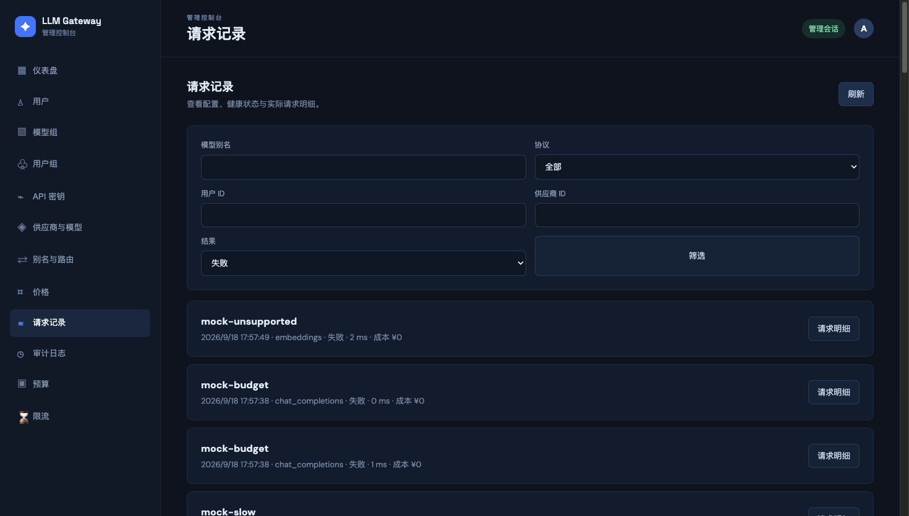

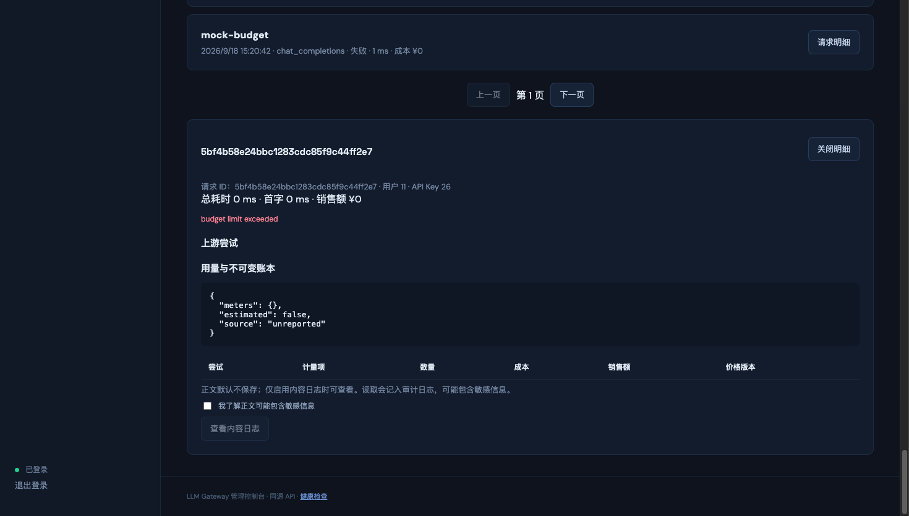

### 6.12 E2E-20 内容日志与读取留痕

网关以 `GATEWAY_CONTENT_LOGGING=true` 启动后，正文以**加密 `bytea`** 落库到 `content_log`（列 `prompt` / `response`，另有 `truncated`、`created_at`；注意表名是单数）：

```sql
SELECT count(*) AS rows, count(prompt) AS with_prompt, count(response) AS with_response,
       bool_or(truncated) AS any_truncated FROM content_log;
-- 55 | 55 | 55 | f
```

控制台路径：请求明细 → 勾选「我了解正文可能包含敏感信息」→「查看内容日志」，对应 `GET /api/admin/content/{record_id}`（`record_id` 即 `X-Gateway-Request-Id`，**不是**信封里的 `request_id`），返回解密后的 JSON。读取本身必须留痕：

```sql
SELECT id, actor_name, action, resource, detail, ip FROM audit_log WHERE detail = 'content log read';
-- 134 | admin | GET | content/a988aeb5c3a4acbc0f601417b600c34a | content log read | 127.0.0.1
```

失败路径同样是显式的：密文不可用时返回 503 `encryption_unavailable`，解密失败返回 500 `content_decrypt_failed`——不会静默返回空正文。这三个判决由单元测试覆盖，本次 E2E 验证的是成功路径与审计留痕。

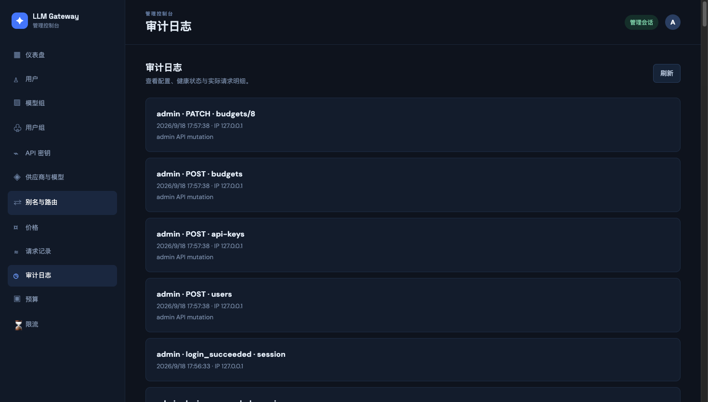

### 6.13 E2E-21 分计量项计价与价格版本固定

`usage_ledger` 的粒度是「每个计量项一行」，且价格版本**按请求固定**（不是按查询时刻取最新版）。`mock-gpt-4o` 同时存在 v1（未定义 `image` 价）与 v2（含 `image=0.02`），当前 E2E 库按 `(别名, 计量项, 价格版本)` 聚合：

| 别名 | 计量项 | 累计数量 | 累计成本 | 累计销售额 | 价格版本 | 验算 |
| --- | --- | --- | --- | --- | --- | --- |
| `mock-image` | image | 1 | 0 | 0 | 1 | v1 未定义 image 价 → 不计费 |
| `mock-image` | input | 4 | 0.000008 | 0.000016 | 1 | 4 x 0.000002 / 0.000004 |
| `mock-image` | input | 20 | 0.000040 | 0.000080 | 2 | 20 x 0.000002 / 0.000004 |
| `mock-image` | image | 5 | 0.10 | 0.20 | 2 | 5 x 0.02 / 0.04 |
| `mock-claude` | input | 9 | 0.000027 | 0.000054 | 1 | 9 x 0.000003 / 0.000006 |
| `mock-claude` | output | 5 | 0.00003 | 0.00006 | 1 | 5 x 0.000006 / 0.000012 |

单请求例子：`aef9e4b0f752de7a45b379564c20995e` 的 `image` 计量项为 1 张 → 成本 0.02 / 销售额 0.04（价格版本 2）。

要点：

- **`image` 是一个独立计量项**，与 token 计量项并行入账。`/v1/images/generations` 的用量由适配器写入 `usage.Meters["image"]`，因此「一张图 0.02 元」这类定价不必用 token 近似。
- **`total` 计量项恒为 0 成本 / 0 销售额**——它是 token 总数的记录行，刻意不参与重复计费。
- 同一别名跨两个价格版本时，账本**分别标注各自的 `price_version`**：v1 的既有请求不会因为后来创建了 v2 而被重算。这印证了「价格版本是不可变快照」的设计承诺。
- 被策略拒绝的请求（429）在 `usage_ledger` 中**零行**、在 `attempts` 中**零行**——拒绝发生在任何上游调用与结算之前，不会产生幽灵费用。

```sql
SELECT count(*) FROM usage_ledger l JOIN requests r ON r.id = l.request_id WHERE r.status_code = 429;
-- 0
SELECT count(*) FROM attempts a JOIN requests r ON r.id = a.request_id WHERE r.status_code = 429;
-- 0
```

## 7. 发现的问题

### 7.1 [P2 → 已修复] 审计日志视图在控制台中不可用

**现象**：侧边栏「审计日志」页面只显示每行记录的数字 ID、状态「启用」和详情「—」，看不到是谁、在什么时候、对哪个资源做了什么。

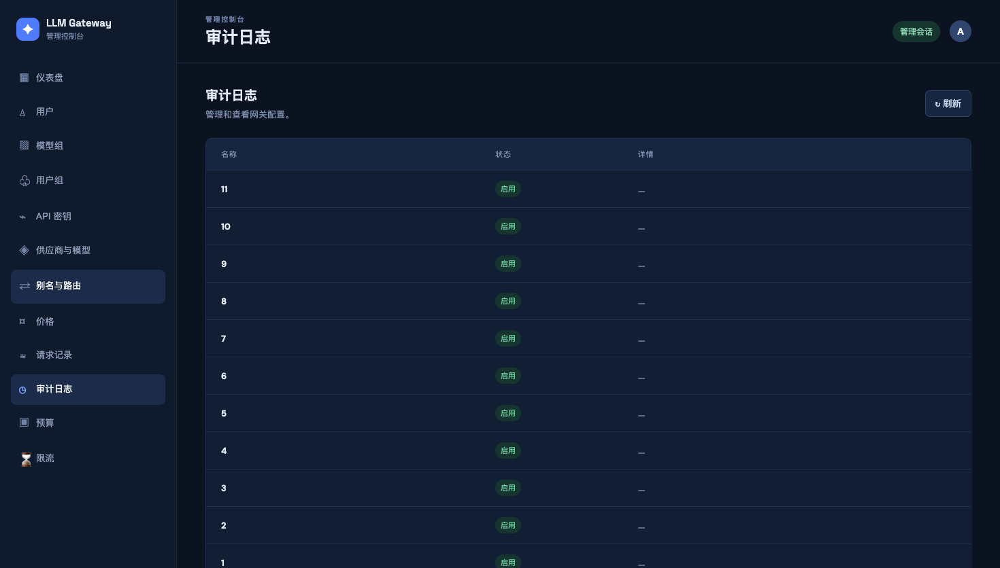

**根因定位**：`frontend/src/App.vue` 中只有 `providers / routing / modelGroups / userGroups / requests` 走 `OperationsPane`（专用渲染），`audit` 落到了通用配置表模板，而该模板只渲染 `名称 / 状态 / 详情` 三列，与审计记录的字段结构（`actor_name / action / resource / ip / created_at`）不匹配。

**后端数据是完整的**，`GET /api/admin/audit` 返回：

```json
[{"id":11,"actor_id":1,"actor_name":"admin","action":"POST","resource":"api-keys",
  "detail":"admin API mutation","ip":"127.0.0.1","created_at":"2026-09-18T09:17:48.202299+08:00"},
 {"id":10,"actor_id":1,"actor_name":"admin","action":"POST","resource":"prices", ...},
 {"id":9,"actor_id":1,"actor_name":"admin","action":"POST","resource":"aliases/1/routes", ...}]
```

**影响**：审计能力对运维人员实际上不可见，只有直接调 API 才能查看——而「谁改了价格/密钥」恰恰是最需要界面可读的合规信息。

**修复（第二轮）**：

1. `frontend/src/App.vue`：把 `audit` 加入 `operational` 视图集合（`App.vue:110`），使其走 `OperationsPane` 专用渲染而非通用配置表模板。
2. `frontend/src/OperationsPane.vue`：为 `audit` 注册标题「审计日志」与只读端点 `audit`；审计视图按 `时间 / 操作者 / 动作 / 资源 / 详情 / IP` 渲染。因为审计是只读的，工具栏的「+ 新建」对 `requests` 与 `audit` 一并隐藏（`v-if="view !== 'requests' && view !== 'audit'"`），行内也不再渲染 `编辑 / 停用 / 删除 / 请求明细` 等写操作按钮。`actor_name` 为空时回退显示为 `用户 <actor_id>`。
3. 后端补齐语义：`backend/internal/httpapi/admin.go` 的 `recordAudit` 原先把所有审计都记成 `admin API mutation`，读写不分；现在 `GET` / `HEAD` 记为 `content log read`，写操作保持 `admin API mutation`（`admin.go:1505-1507`）。同时 `auth.go:137` 在调用 `auditLogin` 前对用户名做 `strings.TrimSpace`，`login_limit.go:81` 的 `auditLogin` 据此把登录事件归属到真实操作者——此前登录审计行的 actor 会丢失。

**修复后实测**（`GET /api/admin/audit` 的最新若干行）：

```
152 | admin | PATCH           | budgets/8  | admin API mutation | 127.0.0.1
151 | admin | POST            | budgets    | admin API mutation | 127.0.0.1
150 | admin | POST            | api-keys   | admin API mutation | 127.0.0.1
149 | admin | POST            | users      | admin API mutation | 127.0.0.1
148 | admin | login_succeeded | session    |                    | 127.0.0.1
```

**回归测试**：新增 `frontend/src/OperationsPane.spec.ts`（172 行）中 2 个 audit 用例——一个断言每行都渲染出时间/操作者/动作/资源/IP 与 `actor_name` 缺失时的回退；另一个断言审计列表**完全只读**（0 个行内按钮、无「+ 新建」、工具栏只剩「刷新」）。


### 7.2 [P3 → 已修复] 未定价模型产生「结算异常」但控制台无引导

**现象**：供应商「发现模型」会把上游全部模型写入模型目录，但价格需要人工逐个创建版本。若某个模型被路由使用却没有价格版本，`attempts.settlement_error` 会被置为 `unpriced`、成本与销售额均为 0。

实测：`missing-model` 的成功尝试即为 `settlement_error = unpriced`，仪表盘「结算异常」计数随之变为 1，但界面没有说明该异常具体指哪一条、如何修复。

**修复（第二轮）**：`frontend/src/OperationsPane.vue` 新增 `settlementHint()`，把结算异常码翻译成可操作的中文说明；「请求记录」明细中的每条上游尝试，若 `settlement_error` 非空即显示提示：

```
未配置价格版本，本次未计费；请在「价格」中为该模型新建价格版本
```

未知的异常码不会被吞掉——原样回显，便于新增码值时不至于静默。

**修复后实测**：路由到无价格版本的 `mock-gpt-4o-slow`（别名 `mock-slow`）与 `mock-unpriced` 的尝试均显示上述引导。

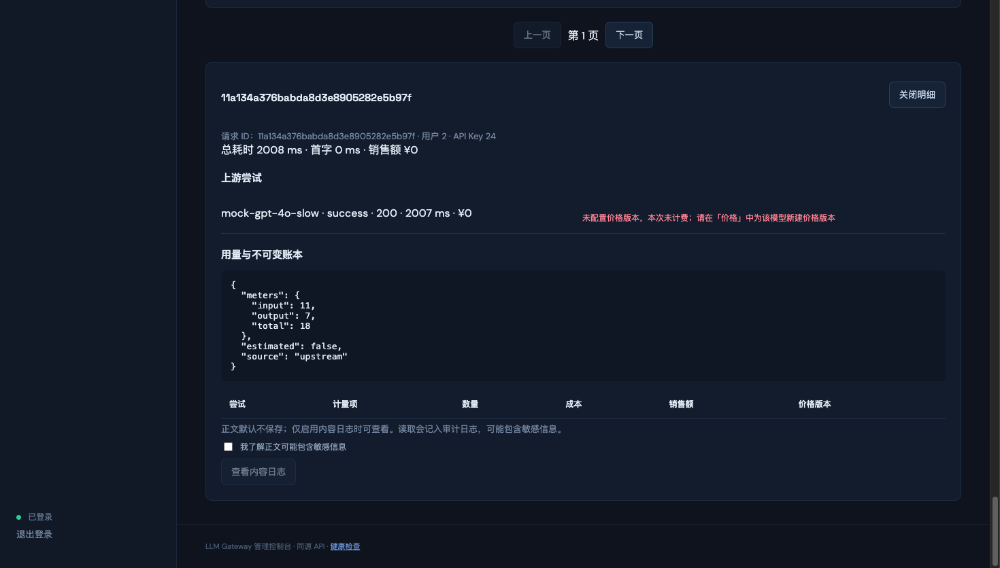

**回归测试**：`frontend/src/OperationsPane.spec.ts` 中 2 个 `settlementHint` 用例——一个断言 `unpriced` 的文案包含「价格版本 / 未计费」且未知码原样回显，另一个挂载 `requests` 视图、点开明细，断言尝试行出现「未配置价格版本」而不是裸的机器值。

### 7.3 [P3 → 保留为已知限制] 流式流被上游截断时的对外表达

当上游 SSE 未以结束标记收尾即断开时，网关在流末尾追加：

```
{"error":{"message":"upstream stream failed","type":"upstream_error","code":"upstream_error"}}
```

同时把尝试记为 `error / 502`，但**已送达的增量内容不会再被撤回**。这是流式协议的固有限制，网关的处理（明确报错 + 记为失败 + 按失败结算）是合理的；此处仅作记录，供 API 使用方编写容错逻辑参考。

### 7.4 [P3 → 已修复] 不支持协议：客户端收到 501，落库却记为 502

**现象**：把 `/v1/embeddings` 路由到一个 Anthropic 供应商时，客户端正确收到 `501 Not Implemented` + `code = operation_unsupported`，但数据库中的请求记录却是 `status_code = 502`、`error_type = gateway`、`error_summary = gateway request failed`。修复前该别名的全部 4 条记录都是这个组合；修复并重启后，同类调用写入的是 `501 / unsupported`：

```sql
SELECT status_code, error_type, count(*) FROM requests
 WHERE model_alias = 'mock-unsupported' GROUP BY 1, 2 ORDER BY 1;
-- 修复前： 502 | gateway     | 4
-- 修复后： 501 | unsupported | 4
```

**影响**：控制台的「请求记录」「成功率」「故障转移 / 结算异常」等统计全部读落库字段，因此界面把一次**调用方配置错误**（协议与供应商类型选错了组合）显示成**网关自身的 502 故障**。这会误导排障方向——运维会去查网关与上游健康，而真正该做的是换一个支持该协议的供应商。

**根因**：`backend/internal/gateway/records.go` 的 `recordError()` 是「错误 → (类型, 摘要, 状态码)」的分类器，对 `ErrModelNotFound`、`ErrNoRoute`、`*adapter.Error` 等分别有分支，**唯独没有 `adapter.ErrUnsupported` 分支**，于是落入兜底：`return "gateway", "gateway request failed", 0`。返回的 `statusCode` 是 `0`，而调用侧只在 `classifiedStatus != 0` 时才用它覆盖默认的 `502 Bad Gateway`（`records.go:185`），所以 0 被当成「未分类」保留成了 502。客户端看到的 501 来自另一条完全独立的路径——`httpapi/gateway.go:405` 的 `writeGatewayError` 映射表（`:413` 即 `operation_unsupported`）——于是出现「对外一套、落库另一套」。

**修复**：在 `recordError` 中补上与 `ErrNoRoute` 并列的分支（`records.go:337-341`）：

```go
// A provider that cannot serve the requested operation is not an upstream
// failure: the client receives 501 and the request record must agree with
// that verdict instead of degrading to a generic 502.
if errors.Is(err, adapter.ErrUnsupported) {
    return "unsupported", "the selected provider does not support this operation", http.StatusNotImplemented
}
```

新增 `unsupported` 作为错误类型标签，与既有的 `rate_limit` / `budget` / `invalid_request` / `routing` / `connection` / `timeout` / `server` / `auth` / `client` / `upstream` / `canceled` / `gateway` 并列；摘要文本与客户端消息保持一致，便于两侧对照排查。

**回归测试**：新增 `backend/internal/gateway/records_test.go`（111 行）：

- `TestRecordErrorClassifiesUnsupportedOperation`：5 个子用例，覆盖 `nil` / 裸哨兵错误 / 包装后的错误 / `rate_limit` / `budget`，确认新分支没有吃掉相邻分类。
- `TestUnsupportedOperationRecordsNotImplemented`：把测试服务的全部供应商置为 Anthropic，用 `protocol.EmbeddingsAPI` 调用 `service.Native`，断言**状态码 501**、`error_type = unsupported`、摘要非空、**0 条上游尝试**、**0 次上游调用**，且销售额为 0。

**顺带确认的一个语义**：这类请求的 `attempts` 行数恒为 0，原因是 `gateway/native.go:120` 拿到 `adapter.ErrUnsupported` 后会 `continue` 到下一条路由，早于 `native.go:144` 的 `recorder.addAttempt(attempt)`。即「不支持」在路由解析阶段就已决定，从未发起上游调用——这既避免了无谓的上游开销，也是修复后 `error_type` 能可靠反映真实原因的前提。

## 8. 未覆盖与局限

| 项 | 说明 |
| --- | --- |
| 多实例分布式协调 | V1 明确非目标，本次未测 |
| 性能与并发压测 | 未做压测；报告中的延迟数字（P50 5 ms / P95 8 ms）仅代表单并发下的本地 mock 链路 |
| 真实厂商上游 | 使用自建 mock 上游，未对接真实 OpenAI / Anthropic / Gemini 端点 |
| 原生协议面的流式（SSE） | 仅 `chat_completions` 验证了流式；`/v1/messages`、`/v1/responses` 的 SSE 形态本次未覆盖 |
| 模型组 / 用户组授权 | 控制台已具备配置入口（`modelGroups` / `userGroups`），本次只验证了 API 密钥级白名单 |
| 诊断类失败路径 | 内容日志的 503 `encryption_unavailable`、500 `content_decrypt_failed`，以及上游流被截断的路径，只有单元测试覆盖，未在 E2E 中构造 |

> 与原版报告相比本表已收窄：协议矩阵、限流/预算拦截、内容日志三项已由 §6.6–§6.13 覆盖并移出；§7.1、§7.2 的界面缺陷已修复，不再计入「未覆盖」。

## 9. 结论

1. **端到端闭环成立**：从控制台登录 → 建供应商 → 发现模型 → 存能力 → 建别名路由 → 定价格 → 签发密钥 → 数据面调用 → 统计与账本回读，全链路在真实进程中跑通，**23/23** 用例通过。
2. **计费正确**：账本逐项金额与价格版本严格吻合；失败请求「计成本、不计销售」的策略在真实数据上得到验证；未定价模型被显式标记为 `unpriced` 而非静默按 0 计费；非 token 计量项（`image`）与 token 计量项并行入账，且价格版本按请求固定、不被后续新版本重算。
3. **安全与合规边界正确**：缺失/伪造密钥返回 401，白名单越权返回 403，`/v1/models` 不泄漏上游真实模型名；内容日志正文加密落库，读取行为强制写入审计。
4. **容灾行为正确**：5xx 触发的故障转移对客户端透明；404 这类调用方错误**不会**被故障转移掩盖；供应商冷却与自动恢复闭环成立。
5. **协议面正确**：6 种协议形态在两类供应商上的分流（原生直通 / 协议翻译 / 不支持）判决一致；不支持协议返回 501 而非笼统 502，且对外的 501 与落库的 501 已经一致。
6. **策略面正确**：rpm / tpm / 并发 / 预算四类拦截都在预期的调用序位上生效，规则解除后立即恢复；被拒绝的请求不留任何上游尝试行与账本行。
7. **本轮共修复 3 项缺陷**：§7.1 审计视图不可读（P2）、§7.2 未定价异常无界面说明（P3）在控制台修复；§7.4「客户端 501 / 落库 502」的不一致在网关修复并补齐回归测试。

## 10. 复现步骤

```bash
# 1) 一次性数据库（E2E 与 strict 门禁各自独立，互不影响）
createdb llm_gateway_e2e

# 2) 构建：make build 会把前端 dist 内嵌进二进制（//go:embed all:static）
make build

# 3) 启动网关（控制台与数据面同源同端口）
GATEWAY_DB_URL='postgres://xd@localhost:5432/llm_gateway_e2e?sslmode=disable' \
GATEWAY_LISTEN_ADDR=127.0.0.1:18090 \
GATEWAY_MASTER_KEY="$(openssl rand -hex 32)" \
GATEWAY_ADMIN_USER=admin \
GATEWAY_ADMIN_PASSWORD='E2eAdmin!2345' \
GATEWAY_CONTENT_LOGGING=true \
GATEWAY_ALLOW_PRIVATE_UPSTREAMS=true \
GATEWAY_BUSINESS_TZ=Asia/Shanghai \
./backend/server

# 4) 打开 http://127.0.0.1:18090 按 §5 顺序完成配置，然后调用数据面
KEY='sk-llm-…'
curl -s -X POST http://127.0.0.1:18090/v1/chat/completions \
  -H "Authorization: Bearer $KEY" -H "Content-Type: application/json" \
  -d '{"model":"mock-chat","messages":[{"role":"user","content":"hello"}]}'
```

> 网关必须先处于监听状态才能跑矩阵脚本；`make build` 一次即可，后续只跑数据面无需重新构建。

### 10.2 数据面与策略矩阵（仓库内一键复现）

§6.6–§6.13 的全部判决都由随仓库提交的 harness 复现，入口是 `scripts/e2e/run.sh`：

```bash
scripts/e2e/run.sh            # 起 mock 上游 → 幂等配置 → 协议矩阵 → 策略矩阵 → 退出时回收 mock
scripts/e2e/run.sh --no-mock  # 复用已在 19099 监听的 mock 上游
```

- `mock_upstream.py`：OpenAI 兼容 mock 上游；`*-slow` 延迟 2 s、`broken-model` 返回 500、`unknown-model` 返回 404，用于构造故障转移与协议分流。
- `setup.py`：幂等配置供应商 / 模型能力位 / 别名路由 / 价格版本 / API 密钥 / 限流与预算规则；脚本自用的密钥每次重新签发，最新明文写入被 gitignore 的 `scripts/e2e/fixtures.json`（仓库内不落任何密钥）。
- `native_matrix.py`、`policy_matrix.py` 也可单独运行；后者默认 `E2E_FRESH_WAIT=62` 秒以等过限流窗口，可用环境变量覆盖。任一判决与预期不符即以非零码退出。
- 脚本以 TCP 轮询等待端口就绪（而非固定 `sleep`），并在 `trap` 中回收自己拉起的 mock 进程。它需要真实数据库、主密钥和可用端口，因此**刻意不纳入 `scripts/test.sh` 门禁**——门禁仍只依赖可离线运行的测试。用法详见 `scripts/e2e/README.md`。

## 11. 附：本次测试同时确认的既有质量门禁

E2E 之外，代码门禁在同一基线上为绿：

- `gofmt -l` / `go vet ./...` 无输出
- `go test -race -count=1 ./...`：13 个包全部 ok、0 个 FAIL（在 PostgreSQL 14 与 16 两个 CI 矩阵腿上分别验证）
- `npm run test`：Vitest **21** 个用例通过（3 个文件：`api.spec.ts` 15、`DashboardPane.spec.ts` 2、`OperationsPane.spec.ts` 4）
- `scripts/test.sh --strict`：`All checks passed.`

本轮修复补齐的回归测试已纳入上述门禁：

- `backend/internal/gateway/records_test.go`：`TestRecordErrorClassifiesUnsupportedOperation`（5 个子用例：`nil` / `sentinel` / `wrapped` / `rate_limit` / `budget`）与 `TestUnsupportedOperationRecordsNotImplemented`（断言 501、`unsupported`、0 条尝试、0 次上游调用），锁定 §7.4 的修复。
- `frontend/src/OperationsPane.spec.ts`：4 个用例——审计视图逐行渲染且完全只读（无任何行内按钮、无「+ 新建」，工具栏只剩「刷新」），以及 `settlementHint` 的文案映射与明细页展示，锁定 §7.1、§7.2 的修复。

## 12. 截图清单

全部截图位于 `docs/e2e/`，均为 1470x836 真实浏览器视口截屏。其中 `01`–`22` 采集于 commit `00f3f1f`，当时控制台显示名仍为 `LLM Gateway`；`23`–`24` 采集于显示层重命名为 `omni-gateway` 之后（见 §13）。改名仅涉及文案，未改动任何页面结构或交互，故 `01`–`22` 的界面证据依然有效：

| 文件 | 内容 |
| --- | --- |
| `01-login.png` | 登录页 |
| `02-dashboard.png` | 登录后仪表盘（空态） |
| `03-provider-form.png` | 新建供应商表单 |
| `04-providers.png` | 供应商列表（已保存） |
| `05-model-discovery.png` | 模型发现完成（2 个模型） |
| `06-model-catalog.png` | 模型目录与能力位 |
| `07-alias-route.png` | 别名 `mock-chat` 的路由配置 |
| `08-price-form.png` | 价格版本表单 |
| `09-prices.png` | 价格列表（版本 1） |
| `10-key-form.png` | API 密钥表单 |
| `11-api-key-secret.png` | 密钥明文一次性展示 |
| `12-dashboard-stats.png` | 仪表盘统计（真实流量后） |
| `13-requests.png` | 请求记录列表 |
| `14-request-detail.png` | 请求明细与不可变账本 |
| `15-audit.png` | 审计日志视图（§7.1 缺陷现场：审计数据被渲染成通用配置表，只剩「数字 ID / 状态 / 详情 —」三列） |
| `16-failover-routes.png` | 双路由优先级配置 |
| `17-failover-detail.png` | 故障转移两次尝试的明细 |
| `18-audit-after.png` | 审计日志视图（P2 修复后）：标题为「审计日志」，工具栏仅剩「刷新」，行内含操作者 / 动作 / 资源 / IP |
| `19-unpriced-hint.png` | 未定价请求明细（P3 修复后）：用量已解析、账本为空，上游尝试行下给出「未配置价格版本…」提示 |
| `20-policy-rejections.png` | 请求记录（结果=失败）：限流 / 预算 / 不支持协议三类拒绝的成本均为 ¥0 |
| `21-policy-rejection-detail.png` | RPM 限流拒绝明细：上游尝试与账本均为空，summary 为 `gateway rate limit exceeded` |
| `22-budget-rejection-detail.png` | 预算拒绝明细：上游尝试与账本均为空，summary 为 `budget limit exceeded` |
| `23-brand-login.png` | 登录页（重命名后）：品牌字样 `omni-gateway` |
| `24-brand-console.png` | 登录后控制台（重命名后）：侧边栏品牌 `✦ omni-gateway 管理控制台` |

---

## 13. 附：项目命名与标识收尾

本报告的 E2E 基线为 commit `00f3f1f`。此后在**不改变任何行为**的前提下，项目的对外名称经 `LLM Gateway` → `xd-ai-gateway`（commit `7d88e3a`，已被后续提交取代）→ 最终定为 **`omni-gateway`**。本节记录最终取值、实际改动范围与验证证据；§13.5 另记录此前推迟的两项标识占位符（Go module path、LICENSE）的收尾。

### 13.1 名称与前缀的选取

最终对外名称为 **`omni-gateway`**，形态为 `<前缀>-gateway`。前缀 `omni`（全部）直指本项目的核心形态：**一个网关统一全部模型、全部上游与全部协议**——Chat Completions / Responses / Messages / Embeddings / Images 五种协议，OpenAI 兼容 / Anthropic / Gemini 三类上游，经别名与有序故障转移收敛到单一入口。

| 项 | 取值 | 依据 |
| --- | --- | --- |
| 名称 | `omni-gateway` | 不需要记忆任何隐喻词的描述型命名；`omni` 即「全部」，与「多协议 / 多上游 / 多模型收敛到单一入口」的定位一一对应 |
| 命名空间独立性 | 产品名不带归属标识 | 产品名本身取描述词而非归属标签，避免把一个尚未确定的归属固化进品牌；归属信息只出现在**必须写归属的工具位置**——Go module path（`github.com/zjvtit/omni-gateway`）与 MIT LICENSE 主体（`omni-gateway contributors`），二者与显示名解耦（见 §13.5） |
| 严格同名占用 | 基本空置 | 可用性核查（GitHub Search API `in:name` + npm registry）：`omni-gateway` 在 npm 为 `404`（未占用），管理端包名 `omni-gateway-admin` 同为 `404`；GitHub `in:name` 命中 87 条，但**严格同名仓库仅 2 个且均为 0 star**（`BlessSusu/omni-gateway` 为 IoT 物联网网关、`vedant381/omni-gateway` 为空仓库） |
| 已知代价 | `-gateway` 是泛词 | 上述 87 条模糊命中中 12 条是 `omnipay-*` 支付网关库，其余还含 IoT 网关等非 AI 项目；即在「模糊命中」层面区分度弱于 `-ai-gateway` 形态，以此换取更短的名称。该取舍为显式选择 |
| 备选（未采用） | `omni-ai-gateway`、`one-ai-gateway`、`mux-ai-gateway` | 三者 npm 均 `404`、GitHub 严格同名均为 0。`omni-ai-gateway` 自描述更强，但 `omni*` 在 AI 网关语义空间已明显拥挤（8 个项目，含 2 个 `OmniAI-Gateway`、`OmniLLM-Gateway`、`OmniGateway`「LLM API 协议转换中间件」）；`one-ai-gateway` / `mux-ai-gateway` 亦可用，最终按项目所有者选择定为 `omni-gateway` |
| 前缀可替换性 | 单条 `sed` 即可更换 | 本轮实际已执行整名替换两次（`xd-ai-gateway` → `one-ai-gateway` → `omni-gateway`），每次只需替换前缀并复跑门禁，改名范围为 §13.2 所列文件 |

### 13.2 本轮实际改动（仅显示层）

| 文件 | 改动 |
| --- | --- |
| `frontend/index.html` | `<title>` → `omni-gateway 管理控制台` |
| `frontend/src/App.vue` | 登录卡片品牌、侧边栏品牌、页脚文案（3 处） |
| `frontend/package.json`、`frontend/package-lock.json` | 包名 → `omni-gateway-admin` |
| `backend/internal/httpapi/ui.go` | 未构建前端时的回退占位页 `<title>` 与 `<h1>`（2 处） |
| `backend/internal/httpapi/handler_test.go` | 回退页断言同步为新名称（`TestEmbeddedFrontendFallback`） |
| `backend/cmd/server/main.go` | 启动日志横幅 → `omni-gateway listening on %s` |
| `Makefile`、`README.md`、`docs/PROJECT_ANALYSIS.md`、`docs/E2E_TEST_REPORT.md` | 标题与正文表述 |

### 13.3 本轮**刻意未改**的标识

以下字符串属于**接口契约、持久化标识或已部署运维标识**。改动会影响存量客户端、已下发的会话 Cookie、既有数据库内容与远端部署，因此不属于「改名」范围：

| 类别 | 位置 | 当前值 |
| --- | --- | --- |
| 管理 API 自述字段 | `backend/internal/httpapi/admin.go:62`（由 `admin_resources_test.go:299` 断言） | `{"service":"llm-gateway-admin","status":"ok"}` |
| 客户端可见的上游归属 | `backend/internal/httpapi/gateway.go:129`（`/v1/models` 的 `owned_by`） | `llm-gateway` |
| 会话 Cookie 名 | `backend/internal/httpapi/auth.go:22` | `llm_gateway_session` |
| 前端 CSRF 存储键 | `frontend/src/api.ts` | `llm_gateway_csrf` |
| 默认数据库 URL | `backend/internal/config/config.go:55` | `postgres://localhost:5432/llm_gateway` |
| 容器 / 卷 / 网络 / 镜像名 | `docker-compose.yml`、`scripts/deploy-podman-remote.sh`、`docs/PODMAN_REMOTE.md`、`.env` | `llm_gateway` |
| API 密钥明文前缀 | `backend/internal/httpapi/admin.go:349` | `sk-llm-`（既有密钥已按此前缀下发，改动会导致存量密钥格式不一致） |

另有若干处是**类别名词而非产品名**的英文描述，刻意保留：`README.md:3` 的 “A single-organization LLM gateway with …”、`scripts/test.sh:4` 的注释 “verification gate for the LLM gateway”，以及 `backend/internal/store/migrations/0001_init.sql:1` 的迁移注释。它们描述的是「这是一个 LLM 网关」这一事实，不构成品牌标识；其中迁移文件已应用，按惯例不再回改。此外 `docs/OPTIMIZATION_IMPLEMENTED.md:3` 出现的 `ai-gateway` 指代的是当时用于能力差距对比的**另一个项目**，不是本项目的名称，同样保留原文。

### 13.4 验证证据

```bash
# 1) 二进制内的旧品牌归零，新品牌就位
$ strings backend/server | grep -c 'LLM Gateway'
0
$ strings backend/server | grep -c 'omni-gateway'
7
$ strings backend/server | grep -c 'xd-ai-gateway\|one-ai-gateway'
0

# 2) 运行态启动横幅（重启后）
$ grep -m1 listening gateway.log
2026/09/19 01:50:18 omni-gateway listening on 127.0.0.1:18090

# 3) 运行态页面与健康检查
$ curl -s http://127.0.0.1:18090/ | grep -o '<title>[^<]*</title>'
<title>omni-gateway 管理控制台</title>
$ curl -s -o /dev/null -w 'healthz=%{http_code}\n' http://127.0.0.1:18090/healthz
healthz=200
$ curl -s -o /dev/null -w 'readyz=%{http_code}\n' http://127.0.0.1:18090/readyz
readyz=200
```

改名后全量门禁复跑通过：`scripts/test.sh --strict` 退出码 `0`，Go `13/13` 包 `ok`、`0` 个 `FAIL`，前端以新包名 `omni-gateway-admin@0.1.0` 完成构建并跑通 Vitest `21/21`（3 个测试文件），末行 `All checks passed.`。其中 `handler_test.go` 的回退页断言已同步为新名称，构成改名后的回归保护。

界面证据为 §12 中的 `23-brand-login.png` 与 `24-brand-console.png`：两张图均由真实浏览器在 `1470x836` 视口现场采集，并以 `tesseract` OCR 复核，均可读出 `omni-gateway` 字样。

### 13.5 标识收尾（原 P4：Go module path 与 LICENSE）

此前唯一被推迟的两项标识占位符已在本轮清除：

| 项 | 变更前 | 变更后 | 说明 |
| --- | --- | --- | --- |
| Go module path | `github.com/example/llm-gateway` | `github.com/zjvtit/omni-gateway` | 改动 `backend/go.mod:1` 与 65 个 Go 文件中的 133 行 import；归属命名空间取仓库所有者在 GitHub 的实际账号（Go 惯例写小写） |
| LICENSE | 专有许可占位符，主体 `Example Org`，附一段要求替换主体的 NOTE | **MIT**，主体 `omni-gateway contributors` | 原文件本身就注明「若计划开源则换为 MIT/Apache-2.0 并附对应文本」，本轮按 MIT 落地；第三方组件仍适用其各自许可，该说明移入 `README.md` 的 License 小节 |

**耦合面已核查**：`Dockerfile`、`docker-compose.yml`、`.github/workflows/ci.yml`、`scripts/*.sh`、`Makefile` 全部以相对路径构建（`go build ./cmd/server`），且不存在 `-ldflags -X <module path>.…` 形式的版本注入。因此 module path 只出现在 Go 源码与 `go.mod` 中，改完无需改动任何构建或部署配置。

`gofmt` 检出了一个真实影响：新路径的字典序与长度变化后，6 个文件的 import 分组需要重排（例如 `github.com/lib/pq` 现在应排在 `github.com/zjvtit/…` 之前）。该问题由门禁的 `gofmt -l` 检出并已修复。

```bash
# 1) 构建信息中的 module path（最直接的证据）
$ go version -m backend/server | head -3
backend/server: go1.23.12
	path	github.com/zjvtit/omni-gateway/cmd/server
	mod	github.com/zjvtit/omni-gateway	(devel)

# 2) 二进制内旧占位路径归零
$ strings backend/server | grep -c 'github.com/example/llm-gateway'
0
$ strings backend/server | grep -c 'github.com/zjvtit/omni-gateway'
593

# 3) 源码侧引用
$ grep -r 'github.com/example/llm-gateway' --include='*.go' backend | wc -l
0
$ grep -r 'github.com/zjvtit/omni-gateway' --include='*.go' backend | wc -l
133

# 4) 重启后的运行态（页面与健康检查见 §13.4）
$ grep -m1 listening gateway.log
2026/09/19 17:07:53 omni-gateway listening on 127.0.0.1:18090
```

改动后门禁复跑通过：`scripts/test.sh --strict` 退出码 `0`，`gofmt -l` 为空、Go `13/13` 包 `ok`、`0` 个 `FAIL`、Vitest `21/21`，末行 `All checks passed.`。
